# Dual Screen Mode

<p align="center">
  
</p>

<p align="center"><strong>Use a Steam Deck or PC handheld as a wireless Wii U GamePad-style second screen for a Linux gaming PC.</strong></p>

Made by slinky.

Setting up a wireless display on Linux was not simple for me.
In my head, the ideal version was always a simple on/off switch: turn it on
when I want the Wii U or DS-style setup, turn it off when I am done, and get
back to playing without opening Konsole every time. Dual Screen Mode
packages an existing KDE, Sunshine, and Moonlight setup into one repeatable
install. The goal is simple: make a Steam Deck or other Linux handheld work
like a Wii U GamePad, a DS or 3DS bottom screen, or just a useful wireless
display without asking people to piece together scattered guides, Reddit posts,
and terminal commands.

This is an early beta I made for SteamOS with KDE Plasma on Wayland.

## Before you start

Dual Screen Mode handles the Linux host. Moonlight is a separate app for the
handheld. On a Steam Deck, it can be installed through Discover. On another
client, use the normal app source for that device.

Pair Moonlight with Sunshine through their normal pairing flow before using the
mode. The wizard can install Sunshine on the host if it is missing, but it does
not install or pair Moonlight on the handheld. A short client setup guide is in
[`docs/MOONLIGHT_SETUP.md`](docs/MOONLIGHT_SETUP.md). I am not an expert in
every client, so it sticks to the basic flow I used.

## What this project handles

Dual Screen Mode prepares the Linux PC that acts as the host. It gives you a
simple on/off shortcut that creates and removes the virtual display, configures
Sunshine for KDE's capture method, routes Sunshine's virtual touchscreen to the
virtual display when KWin exposes it, and applies the selected audio behavior
for the session.

## What you need

### Host PC

This is the computer that runs the games and sends the virtual display to the
handheld. It needs:

- SteamOS or another Arch-based Linux installation
- KDE Plasma running on Wayland
- A working Flatpak installation
- A graphics device supported by Sunshine's encoder
- The host and handheld connected to the same local network

The wizard checks the host before it changes anything. It can guide you through
installing KDE's `krfb` package through `pacman`, and it can install Sunshine
from the official Flathub app ID `dev.lizardbyte.app.Sunshine` if Sunshine is
not already present.

If `krfb` is missing, the wizard pauses and opens a visible Konsole window for
the package installation. Enter the normal administrator password in Konsole,
wait for the package operation to finish, close that terminal, and click
**Check again** in the wizard. The wizard continues only after it confirms that
`krfb-virtualmonitor` is available. Dual Screen Mode does not handle, collect,
or store the administrator password.

If setup needs to be stopped, closing the wizard asks for confirmation and
stops the installer process; it does not remove anything that was already
installed.

### Handheld or client

- A Steam Deck, another PC handheld, tablet, or phone with Moonlight
- A screen resolution that matches one of the available virtual display sizes
- Gamepad support enabled in Moonlight when you want the handheld controls sent
  to the host

## Install

The short version is:

1. Download the latest release from GitHub and extract it somewhere easy to find, such as your Desktop.
2. Open the extracted folder and double-click `Install Dual Screen Mode.desktop`.
3. Choose **Launch** if KDE asks what to do with the file. Do not choose **Open with Kate**.
4. Click **Begin setup** and follow the wizard.
5. If the KDE virtual-display package is missing, approve its installation in Konsole, close Konsole when it finishes, and click **Check again**.
6. Continue through the wizard and let it create the two desktop shortcuts.

## Visual setup guide

<details>
<summary>Open the step-by-step guide</summary>

You do not need to know how to use GitHub or the Linux terminal to follow this guide. The screenshots show what to click and explain what should happen next.

#### 1. Open the latest release

On the Dual Screen Mode GitHub page, click **Releases** on the right side.

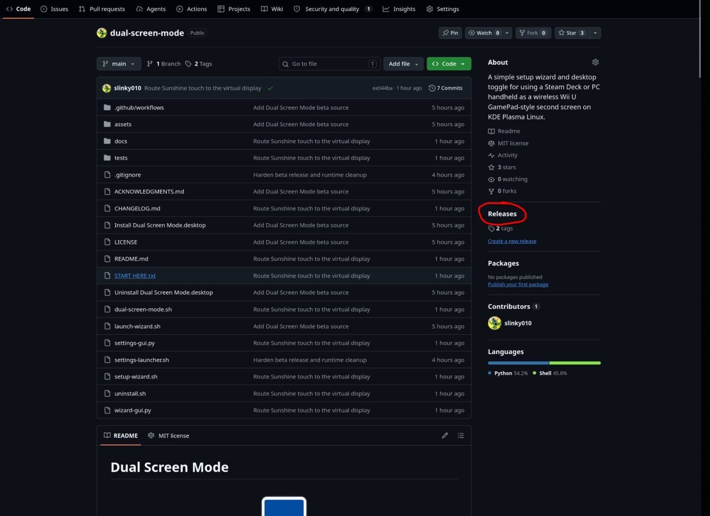

#### 2. Download the package

Open the newest release and expand **Assets**.

Download the `.tar.gz` package. It is a compressed package, similar to a `.zip` file. Do not choose the individual source files or the **Source code** downloads.

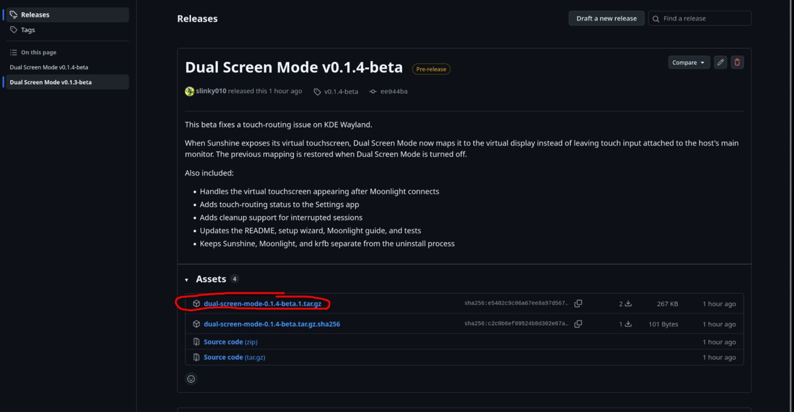

#### 3. Extract the package

Open the downloaded `.tar.gz` file with Ark, KDE's archive utility, and click **Extract**.

Choose an easy-to-find location, such as your Desktop. You do not need to extract the files one at a time.

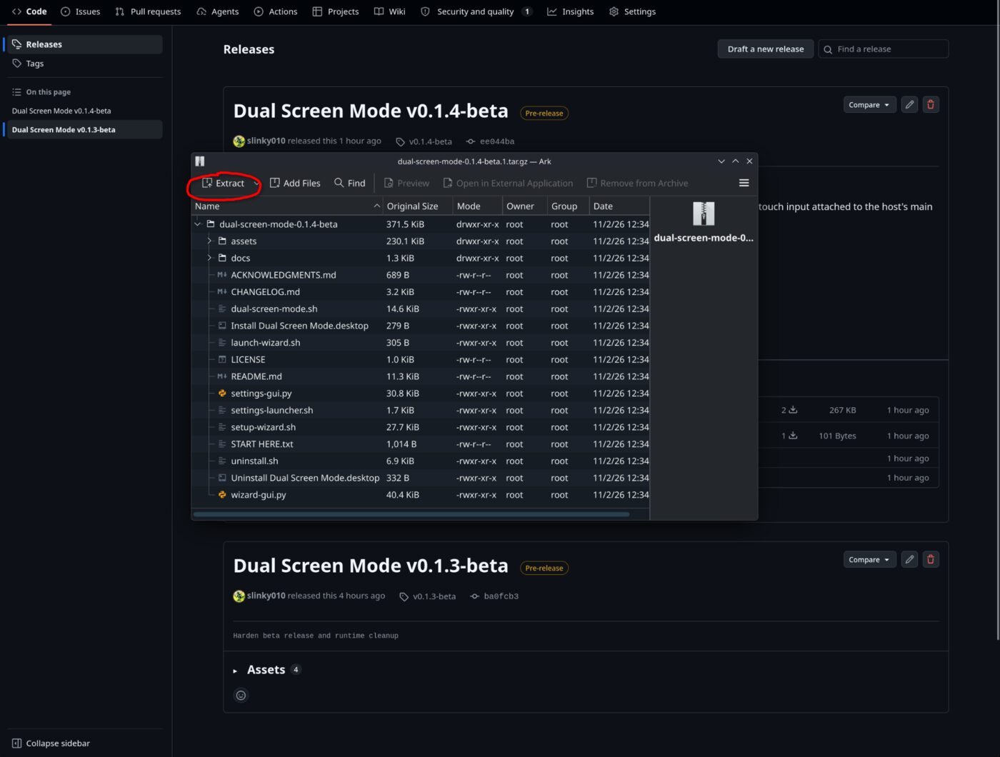

#### 4. Open the installer

Open the extracted Dual Screen Mode folder and double-click **Install Dual Screen Mode.desktop**.

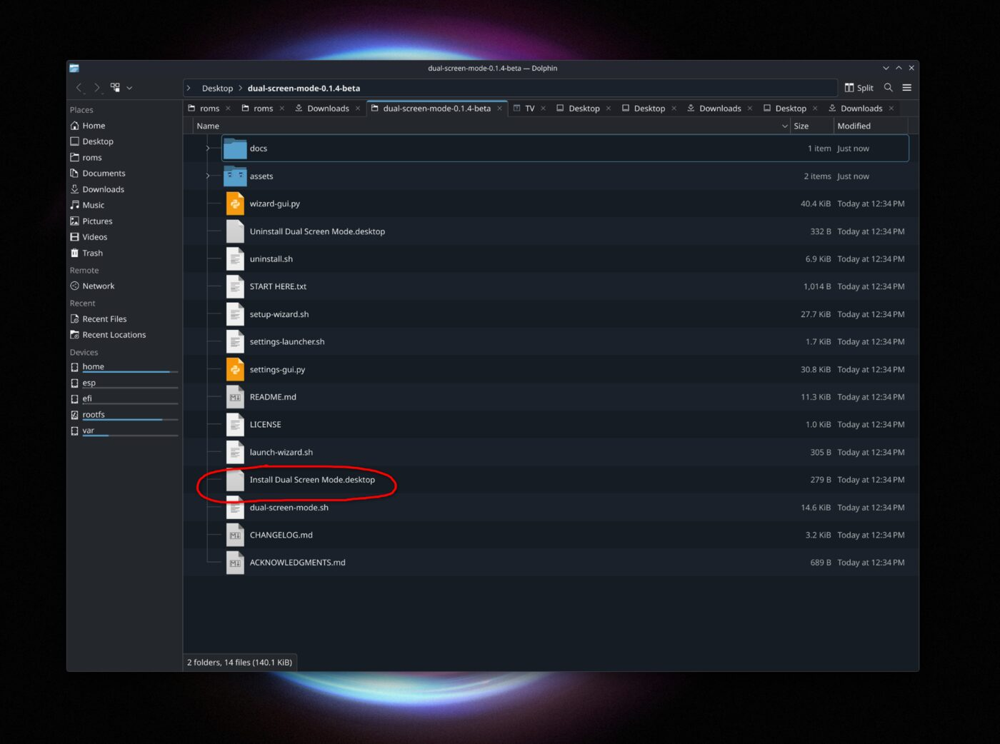

When KDE asks what you want to do with the file, choose **Launch**. Do not choose **Open with Kate**. Kate is a text editor, so that would only show the file contents instead of starting the installer.

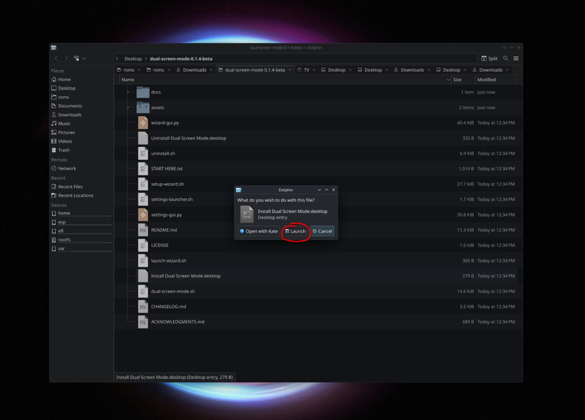

#### 5. Start the setup wizard

The welcome screen explains what Dual Screen Mode will set up. When you are ready, click **Begin setup**.

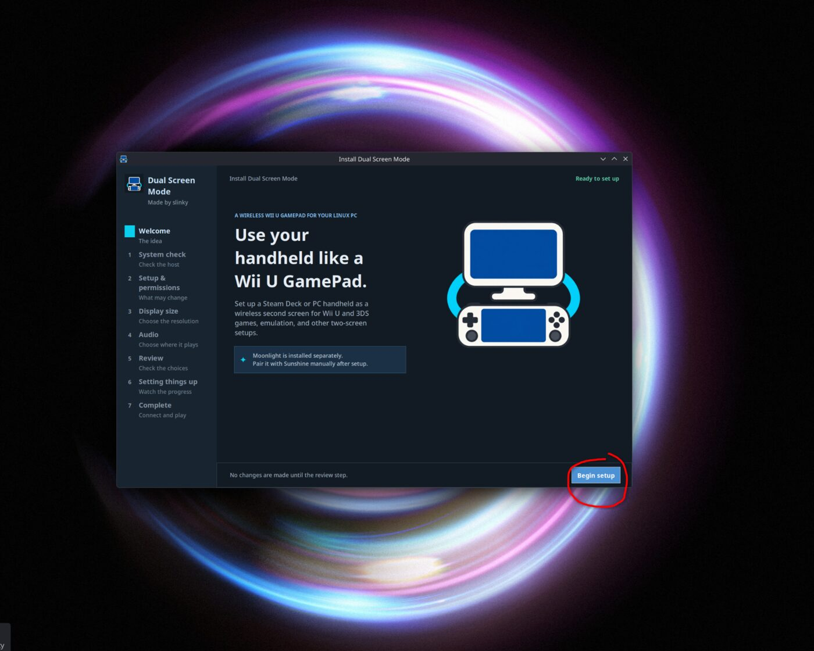

The wizard checks the host computer for the pieces it needs and handles the setup for you. It will explain anything that is missing before continuing.

#### 6. Install the KDE virtual-display package if needed

If the KDE virtual-display package is missing, the wizard will tell you what to do. Click **Open installation terminal**.

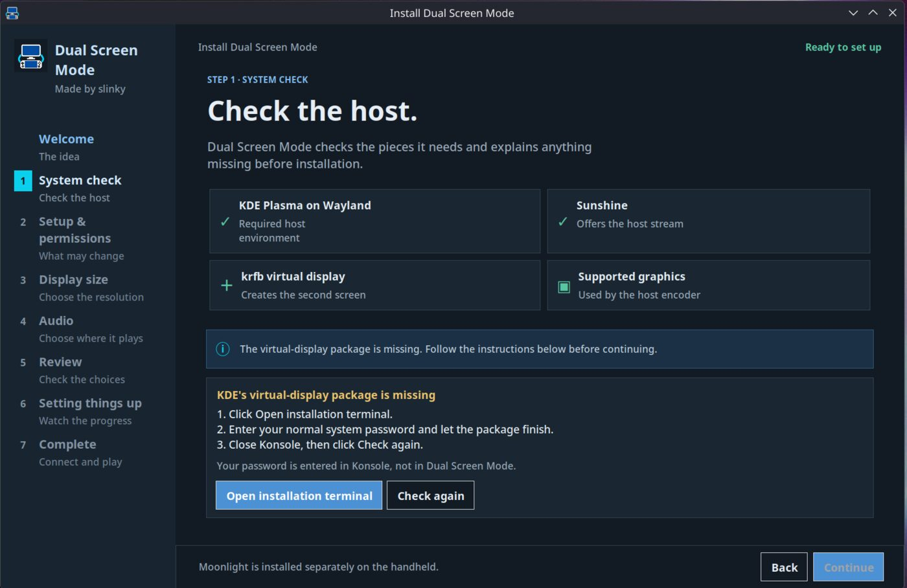

Konsole will open and ask for your normal system password. The password is entered in Konsole, not into Dual Screen Mode.

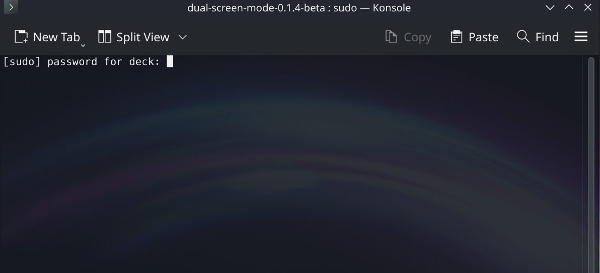

Approve the package installation and wait for it to finish.

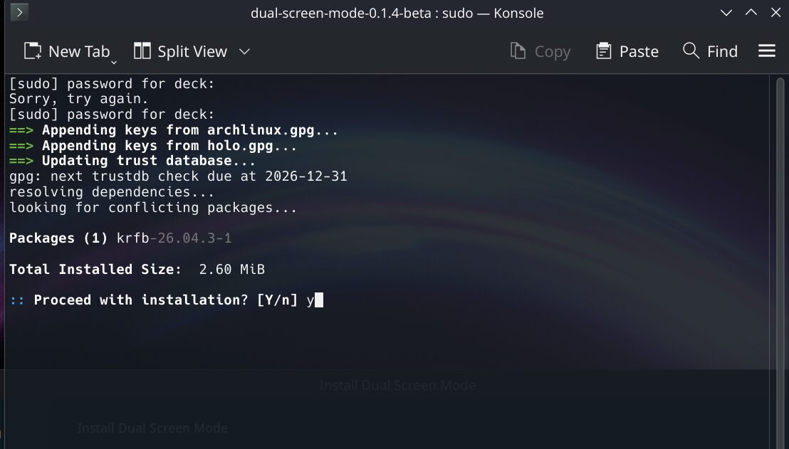

When the installation is complete, close Konsole and return to the wizard. Click **Check again**.

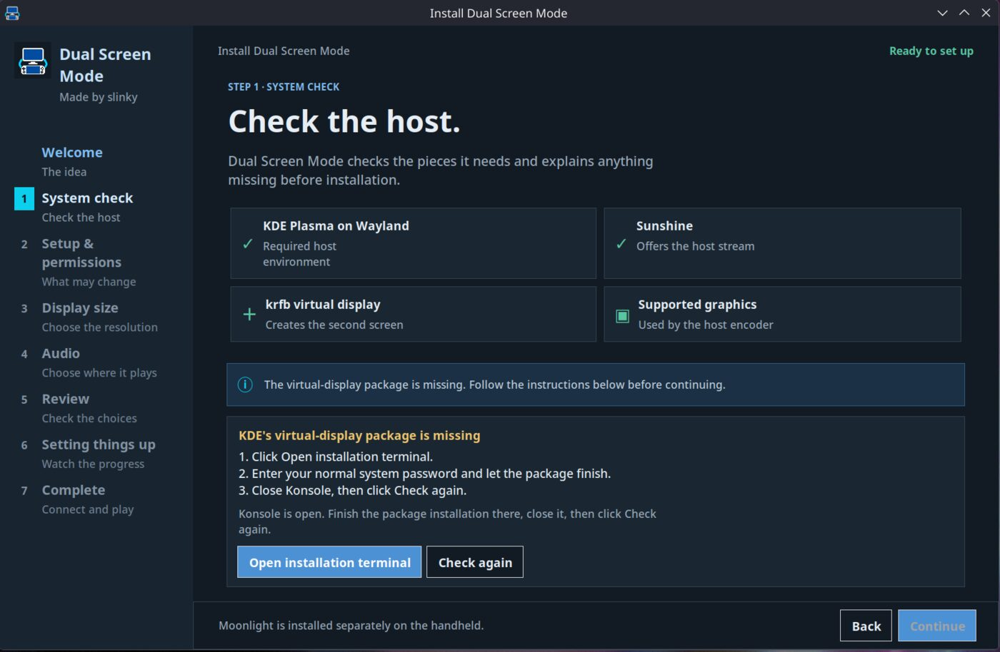

The wizard will confirm that the required pieces are ready. Once the check passes, **Continue** becomes available.

#### 7. Finish the setup

Click **Continue** and let the wizard finish setting everything up.

When setup is complete, two shortcuts will be created on your Desktop:

- **Dual Screen Mode** turns the virtual display on or off.
- **Dual Screen Mode Settings** opens the management app for status, settings, updates, help, about, and uninstall.

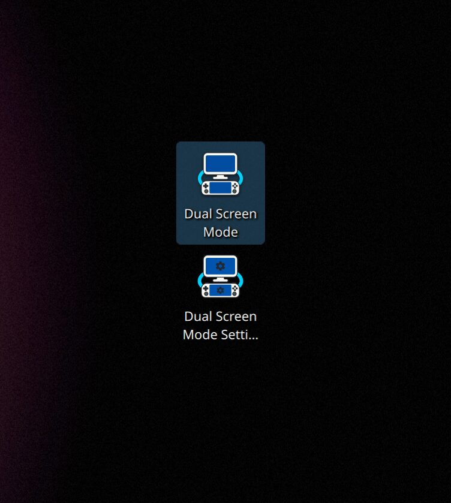

#### 8. Turn on Dual Screen Mode

Double-click **Dual Screen Mode** on your Desktop.

This turns on the virtual display and prepares Sunshine for the connection. You do not need to open Sunshine manually.

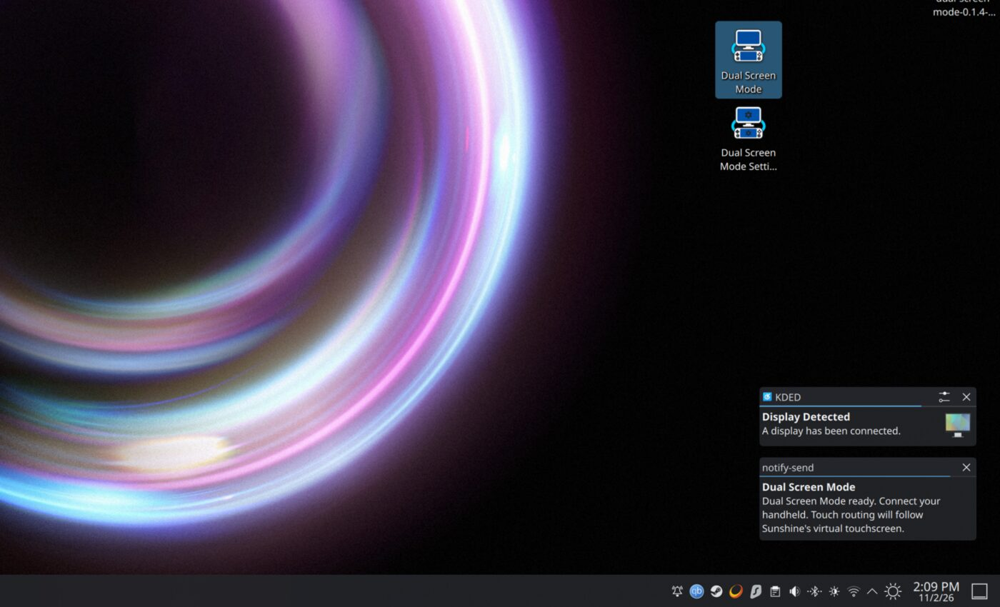

Open Moonlight on your handheld and connect to the host. Moonlight must already be installed and paired separately.

#### 9. Uninstall if you change your mind

Open **Dual Screen Mode Settings** from the Desktop and choose **Uninstall**. The settings app removes Dual Screen Mode and its own changes without removing Sunshine, Moonlight, or `krfb`.

</details>

## Normal use

1. Double-click **Dual Screen Mode** on the host.
2. Wait for the virtual display to be ready.
3. Open Moonlight on the handheld and connect to the paired host.
4. Start the stream. Use Moonlight's gamepad mode when you want the handheld
   controls sent to the host.
5. Double-click **Dual Screen Mode** again when you are finished.

The virtual display remains active if Moonlight disconnects. That allows the
handheld to reconnect without rebuilding the display.

### Touch behavior

When the mode is active, the toggle watches for Sunshine's virtual touchscreen
and tells KWin to use `Virtual-DualScreen` for it. This is the part that keeps
touch input on the handheld display instead of sending it to the host's main
monitor. The previous KWin mapping is saved and restored when the mode turns
off.

This handles the host-side display routing. Touch behavior inside Cemu,
Azahar, or another emulator still depends on that application's own input
settings.

## What I tested

I made this for my Steam Machine and Steam Deck. The virtual display showed up
as a second monitor and worked wirelessly over the local network pretty
seamlessly.

For controls, I used Moonlight's gamepad mode on the Deck so its controls were
sent to the host. In Cemu, I had to set up some input manually, although some
of that was probably me still learning Cemu. In Azahar, I used its automap
function. The display and streaming setup are separate from each emulator's
own controller profile and input settings.

I did not verify gyro or microphone forwarding, so this project does not claim
to support them yet. I would like to look into that in the future to make Wii U
and 3DS setups smoother.

## What is outside this project

Dual Screen Mode prepares the virtual display, Sunshine capture, Sunshine's
virtual touchscreen routing, streamed input connection, and optional session
audio behavior. It does not configure Cemu, Azahar, another emulator,
game-specific controller profiles, gyro, or microphone forwarding. Those are
separate from the host display setup and need to be configured independently.

## Audio behavior

The wizard makes the audio choice explicit:

- **Host:** Sunshine audio streaming is disabled. Host audio is left alone.
- **Handheld:** Sunshine audio streaming is enabled. The current default host
  output is muted for the session.
- **Both (work in progress):** This is intended for audio on both the host and
  handheld. I have not verified that behavior reliably yet, so it currently
  uses Handheld behavior: Sunshine audio streaming is enabled and the current
  default host output is muted for the session.

Before a temporary change, the toggle saves Sunshine's current audio-stream
setting and, when available, the current default output's volume and mute state.
Those values are restored when the mode turns off.

The project does not change the system's default output, install an audio
driver, create a blank or virtual audio device, or alter other outputs. On
PipeWire systems, it uses the existing PulseAudio compatibility interface. If
the host output cannot be muted automatically, it is left unchanged and a
warning is shown.

## What the installer changes

The setup can:

- Install `krfb` if the virtual display component is missing.
- Install Sunshine from Flathub if it is missing.
- Add a user-level KWin screencast setting required by this capture method.
- Configure Sunshine to use KWin capture and `Virtual-DualScreen`.
- Save the selected display size and audio preference.
- Generate a fresh temporary virtual-display password for each session without
  saving it as a user credential.
- Watch for Sunshine's virtual touchscreen and map it to `Virtual-DualScreen`
  through KWin while the mode is active, restoring the previous mapping when it
  turns off.
- Create a user-local on/off toggle, management app, desktop shortcuts, and
  icons.

It does not add a background daemon, telemetry, advertisements, bundled
software, or an automatic network configuration. It does not remove Sunshine,
Moonlight, `krfb`, or user backups during uninstall.

## Uninstall

Open **Dual Screen Mode Settings** from the desktop, then choose **Uninstall**
inside the management app. It removes only files and settings owned by Dual
Screen Mode.

Sunshine, Moonlight, `krfb`, and user backups remain installed.

## Supported setup

The currently validated setup is:

- SteamOS or Arch-based Linux
- KDE Plasma on Wayland
- Sunshine Flatpak
- Moonlight client
- KDE `krfb-virtualmonitor`
- Sunshine KWin capture

The host must remain in KDE Desktop Mode while the virtual display is active.
Switching a SteamOS host to Gaming Mode ends the desktop session that owns the
virtual display.

## Work in progress

This is a one-person beta. I was making it for myself, but thought it would be
fun to share. I only have my own Steam Machine and Steam Deck to test with, so
other KDE, graphics, Plasma, and handheld combinations may still have rough
edges that I have not encountered.

The current known limits are:

- **Both** audio is still a work in progress and currently behaves like
  **Handheld** audio.
- Touch routing depends on Sunshine exposing its virtual touchscreen and KWin
  exposing the input-device mapping. Emulator-specific touch behavior, gyro,
  and microphone forwarding are outside this project.

If you try it and something breaks or behaves strangely, please open an issue
on GitHub and include what host, handheld, desktop session, and display setup
you were using. That will make it much easier to tell whether the problem is
specific to one setup or something the project needs to handle. This is my
first project like this, so please have patience with it.

## If something goes wrong

### Moonlight cannot find or pair with the host

Make sure Sunshine is running on the host, Moonlight has been paired with it,
and both devices are on the same local network. Pairing is handled through the
normal Sunshine and Moonlight flow, not by Dual Screen Mode.

### The handheld shows the main monitor instead of the second screen

Turn Dual Screen Mode off and on again, then reconnect Moonlight. The host
should show a virtual output named `Virtual-DualScreen`.

### Touch lands on the wrong monitor

Turn Dual Screen Mode off and on again, then reconnect Moonlight. While the
mode is active, its status page should show touch routing as mapped or waiting
for Sunshine's virtual touchscreen. If Sunshine does not expose a virtual
touchscreen, Moonlight's trackpad or mouse controls may still work, but there
is no host touch device for Dual Screen Mode to route.

### The stream is hard to read

Open **Dual Screen Mode Settings** and choose a display size that matches the
handheld. Moonlight's own stream settings are outside this project.

### The Settings app does not open

Rerun the installer from the current package so the settings app and launcher
are replaced together. If it still fails, inspect:

```text
~/.local/state/dual-screen-mode/settings-gui.log
```

The Settings app's Help page can also open the Sunshine log and copy a small
diagnostic summary.

## Source and tests

The source is plain shell and Python and can be inspected directly. The tests
in `tests/` are for checking the project during development and are not needed
for a normal installation. There is no remote shell script and no `curl | bash`
install path.

## Credits and license

Dual Screen Mode is a packaging and configuration layer around existing tools
and community knowledge. It does not replace or claim ownership of Sunshine,
Moonlight, KDE, `krfb`, or the guides that informed the setup.

See [`ACKNOWLEDGMENTS.md`](ACKNOWLEDGMENTS.md) and [`LICENSE`](LICENSE).
